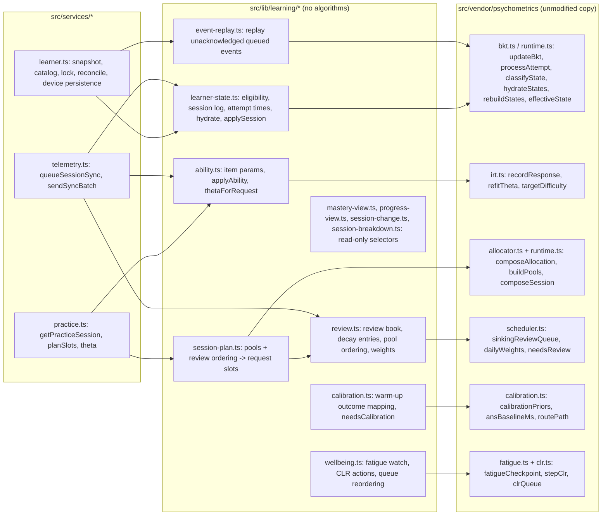
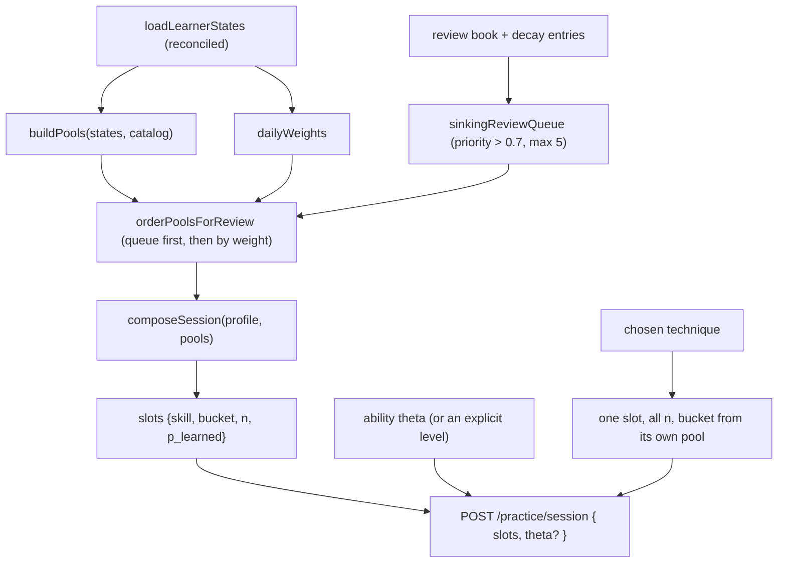

# Adaptive learning architecture

All numbers and rules come from the vendored engine in `src/vendor/psychometrics` (an unmodified copy of the backend monorepo's `packages/psychometrics`). The app's own code under `src/lib/learning` only feeds it real outcomes and uses what it returns.

## 1. Components

## 2. Responsibilities and status

| Responsibility | Where | Status |
|---|---|---|
| BKT mastery (`processAttempt`, decay, state machine) | engine, driven by `learner-state.ts` / `learner.ts` | **Complete** (Practice, Sprint, warm-up) |
| Fractured / Fragile / Fluid | engine state, shown by `mastery-view.ts` and chips | **Complete** |
| IRT ability (2PL-lite) | `ability.ts` over `recordResponse`, kept per subject by `ability-book.ts` | **Complete** locally. Recovery on a new device is implemented against the agreed response shape and tested with simulated data; it **needs the backend** (`BACKEND_TEAM_HANDOFF.md` T1) |
| Quant and Data Insights separately | one estimate per subject the backend names; items with no subject feed a local-only "unclassified" estimate that is never sent and never counted as Quant | Frontend **complete**; subjects **Blocked** until the backend names them (T2) |
| Adaptive allocation | engine `composeAllocation` (60/20/20 default, persona/cluster) | **Complete** |
| Session composition | `session-plan.ts` -> `POST /practice/session` slots with `p_learned` | **Complete** |
| State hydration and reconstruction | `hydrateStates` + `rebuildStates`, event-sourced reconcile | **Complete** |
| Calibration | warm-up flow, `calibrationPriors`, `ansBaselineMs`, `routePath` | **Complete** on the device. Server storage **Blocked** (no write route for the baseline or `active_path`) |
| Revision scheduling | `review.ts` over the scheduler | **Complete** on the device. Server `sinking_skills` has no writer, so it is not shared between devices (**Blocked**) |
| Fatigue and cognitive load | `wellbeing.ts`, `use-wellbeing.ts`, break overlay | **Complete** for Practice (interventions). Timed Sprint **records the checkpoint only** (no break, hint or reordering). The engine marks its weights and thresholds as provisional and the UI makes no claim about them |
| Per-question cognitive load (`cognitive-load.ts`) | `cognitiveLoadOf` calls the engine's `bclFeatures` and `baseCognitiveLoad` on the question text (the engine's own counting); it is the tiebreak in `clrQueue` ordering and is logged as `bcl` on each attempt. Separate from IRT difficulty | **Complete**. No backend metadata is required (T7) |

## 3. How the plan is decided

- An explicit difficulty (Beginner, Advanced, a technique-page level) sends the matching theta; only "Adaptive" sends the learner's own ability. Tested in `learner-model-features.test.tsx`.
- A chosen technique is never padded with another technique's questions (`practice.ts` filters the top-up by skill; tested in `technique-practice.test.ts`).

## 4. Persistence split

| Kind | Where | Cleared on logout | Cleared on account deletion |
|---|---|---|---|
| Account (auth, onboarding, settings, plan, habits) | zustand `persist` in localStorage | yes (`resetAppState`) | yes |
| Learner psychometrics (snapshot copy, theta, review book, calibration, warm-up draft) | localStorage keys from `lib/learning/storage-keys.ts`, per learner id | **kept** (so offline work and re-login keep their data) | **wiped** (`purgeUserData`) |
| Unsent events | Dexie `eventQueue`, per learner id. An acknowledged batch is removed only inside the transaction that parks any rejected events; it also advances the remembered snapshot and the acknowledgement counter that invalidates cached reads | **kept** | **wiped** |
| Mastery timeline | Dexie `masteryHistory`, per learner id | **kept** | **wiped** |
| Device id | `zuzumik:device-id`, one per install, sent with every sync | kept | kept (it names the install, not the person) |
| Server mastery snapshots | backend `bkt_state_snapshots`, written from `session_end.technique_states` | n/a | server side |

## 5. Not part of the learner model (by design)

XP, streaks, habits, leaderboards, ghosts, the daily challenge and friends never touch BKT or IRT. A test (`session-views.test.ts`) fails if any of them imports the engine or the learner model, or if the learner model imports any of them.
