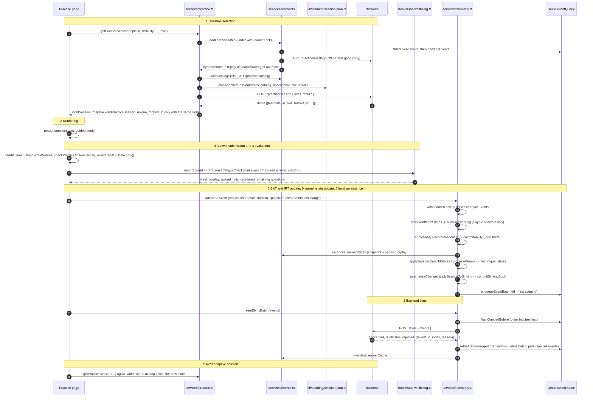
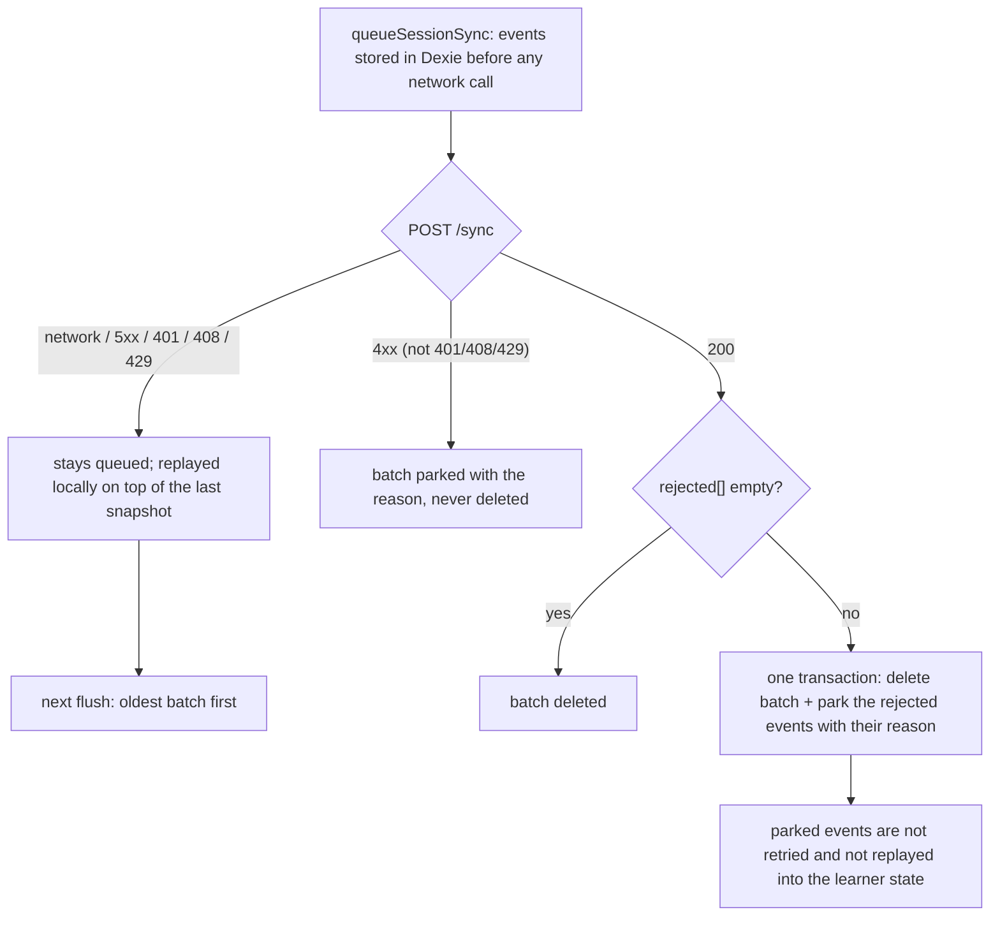

# Answer lifecycle

The path of one answer, from the question being chosen to the next adaptive session, traced through the real functions. File paths are under `src/`. Guided Practice (`app/(app)/learn/practice/page.tsx`) is the reference flow; differences for the Sprint are at the end.

## 1. Sequence

## 2. What counts as a scored answer

`attemptEligibility` (`lib/learning/learner-state.ts`) is the single gate for BKT, IRT, the fatigue watch and the review book. An answer is excluded when it is unanswered, deferred (server-graded: `correct === null`), has no canonical skill id (`skillId`), is sandbox content (`trustStatus === "sandbox"`), or has `feedsMastery === false`. The same problem twice in one list counts once, and IRT counts only the first scored attempt per problem.

## 3. Timestamps

Each answer stores `answeredAt` (device time at submission). `resolveAttemptTimes` is the one source for BKT replay, forgetting decay, IRT order and the `problem_attempt` event stamp:

- usable `answeredAt` (after 2020 and at most 5 minutes ahead of now) is used and labelled `at_source: "actual"`;
- anything else falls back to a reconstructed time (session end minus the durations still to come), labelled `"reconstructed"`;
- times never decrease and never exceed now, so a clock that steps backwards cannot reorder attempts.

Queued events that predate this carry no `skill_id` and are skipped from the local replay (they are still delivered). Their `client_timestamp` is one shared stamp per batch, so they keep their array order.

Every attempt event also carries the engine's `bcl` (base cognitive load) for its question, when the question has text.

## 4. Offline and failure handling

- When a batch is acknowledged, the transaction that removes it also advances the remembered snapshot with that batch's `technique_states` and bumps an acknowledgement counter, so a cached older server snapshot is never used for the next session. An acknowledged session cannot disappear from the learner's state, online or after an offline restart.
- Ability is routed by subject: each eligible answer updates the estimate of the subject the backend named for its item; an item with no subject updates a local-only estimate that is never sent.
- Duplicate delivery is harmless: the server deduplicates on `event_id`, the queue is keyed by the batch's first event id, and the local replay applies each event id once.
- Two sessions finishing together are serialised by `withLearnerLock`, so the second starts from a state that already contains the first.
- A browser or Android restart keeps Dexie and localStorage, so queued events and the remembered snapshot survive; the session itself is not resumable in Practice.

## 5. Sprint differences

`/play/sprint` builds its questions with `getSprintQuestions -> getPracticeSession` (same planner, same request), but answers live in `stores/sprint-store.ts` and are synced from the results page through `syncSprintResult -> queueSessionSync` (same pipeline, same lock). The sprint records the engine's fatigue checkpoints (observe only, handed to the results screen and logged with the result) and never interrupts the learner. An explicit level (Beginner = 2, Advanced = 4) is sent as the matching theta; "Adaptive" sends the learner's own ability.
