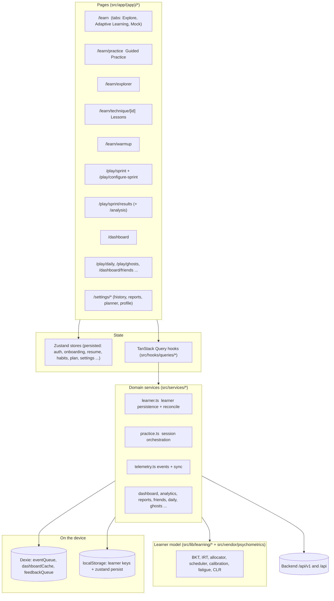

# Architecture overview

Verified against the source on 2026-11-06 (branch `feature/backend-integration`). Every status below was checked in code, not inferred from a file name.

Status words: **Complete** (works end to end and is tested), **Partial** (exists, not fully integrated), **Not implemented**, **Blocked** (needs a backend change).

## 1. Layers

## 2. Feature map

| Feature | Route | Uses the shared learner model? | Status |
|---|---|---|---|
| Guided Practice | `/learn/practice` | Yes: hydration, planner, BKT, IRT, review book, fatigue/CLR, sync | **Complete** |
| Timed Sprint | `/play/sprint` | Yes for session planning and result sync (BKT, IRT, review book). No fatigue watching (a different, timed format) | **Complete** for the model, fatigue **Not implemented** |
| Sprint Results | `/play/sprint/results` | Yes: shows the mastery change the pipeline computed, plus the next step | **Complete** |
| Sprint Analysis | `/play/sprint/results/analysis` | Partly: accuracy by technique and difficulty from the session, with each technique's engine label beside it. It does not show history trends | **Partial** |
| Topic Explorer | `/learn/explorer` | Yes: Fractured / Fragile / Fluid labels on technique nodes and in the mastery panel. Bank sub-topics have no skill mapping and stay unlabelled | **Partial** (backend mapping) |
| Technique Lessons | `/learn/technique/[id]` | No mastery shown. It links into practice by skill and level | **Partial** |
| Adaptive Learning tab | `/learn?mode=adaptive` | Yes: warm-up, progress, next step, revision, personalised mix, today's plan (engine-driven in real mode) | **Complete** |
| Topic mastery in the tab's dashboard | same | Reads the same persisted snapshot through a display mapping (`mapBackendMastery`), not through the engine | **Partial** |
| Dashboard | `/dashboard` | No: server-computed `/dashboard/*` data | **Not integrated** (by design: it shows behaviour and server summaries) |
| Analytics, Reports, History | `/settings/*` | No: server data (`/dashboard/stats`, `/mocks/history`) | **Not integrated** |
| Habit tracking | stores/habit-store | Separate on purpose (a test pins that it never imports the learner model) | **Complete** (separation) |
| Social competition (daily, ghosts, friends, leaderboard) | `/play/*` | Separate on purpose (same test) | **Complete** (separation) |

## 3. What is not what it looks like (stale or misleading code)

- `src/lib/adaptive/engine.ts` (`applyOutcome`, `difficultyFor`, `lengthFor`) is a **mock-mode heuristic**. In real mode only `recommendPlan` (mock rhythm and time budget) is still used, and only as the fallback when the learner's history cannot be read.
- `src/stores/adaptive-store.ts` (`zuzumik-adaptive`) holds mock-mode state; real mode only resets it.
- `recordAdaptiveSession` in `src/services/adaptive.ts` has no callers (dead code).
- `src/lib/mock/*` is development-only fixture data (`NEXT_PUBLIC_API_MOCK=true`).

See `ARCHITECTURE_GAPS.md` for the full checklist.
